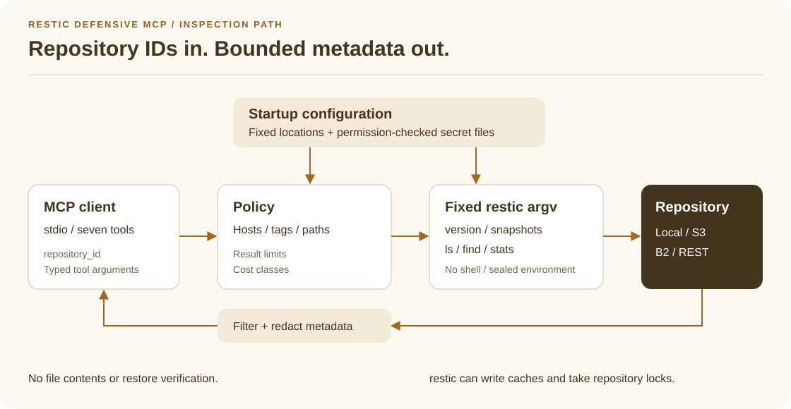

<!-- README standard: filmcraft-inspired/v4; profile: backend -->

<a id="restic-defensive-mcp"></a>
<h1 align="center">restic-defensive-mcp</h1>
<p align="center"><b>Inspect restic backups through seven restricted MCP tools.</b></p>

List snapshots, browse file metadata, find paths, and get size/count statistics
from [restic](https://restic.net) repositories through a local stdio
[MCP](https://modelcontextprotocol.io) server.

<p align="center">
  <a href="#get-started">Get started</a> ·
  <a href="#tools-exactly-seven">Tools</a> ·
  <a href="#configuration">Configuration</a> ·
  <a href="#documentation">Documentation</a> ·
  <a href="#status">Status</a>
</p>

<a id="privacy-limits"></a>
<!-- readme:section positioning -->
## Why this project?

Use this server when an MCP client needs to inspect existing backups within
operator-defined boundaries. The client selects a configured `repository_id`;
repository locations and backend credentials stay fixed after startup. Host,
tag, and path policies apply on the server before metadata reaches the client.

The runner uses no shell and accepts only `version`, `snapshots`, `ls`, `find`,
and `stats` with controlled arguments. There is no free-form `run_restic` tool,
repository URL argument, backup management, or file-content extraction.
Read-only inspection can still use a local cache and repository locks.

**Accounts:** The server needs no product account. It requires an existing restic repository and its password file; remote storage may also require provider credentials. Your MCP client or model provider has its own account requirements.

**Telemetry:** The server implements no telemetry, crash reporting, or automatic update checks. Operational and audit JSON logs go to stderr; audit events omit full file paths. Client-side telemetry is controlled by your MCP client.

**Data:** The server reads local configuration and secret files, keeps sealed repository locations and backend credentials in memory, and returns permitted backup metadata to the MCP client. Restic can write a local cache and contacts the configured backend for remote repositories. Your client may send returned metadata to its model provider; local stdio does not make that processing local-only.

Names, paths, hosts, tags, sizes, and timestamps can be sensitive. Responses
exclude file contents and configured repository locations and secret-file paths;
strings are sanitized and redacted, and result sizes are bounded. Choose
allowlists for the metadata you are willing to expose. See the
[security policy](SECURITY.md) for the threat model and residual risks.

<!-- readme:section capabilities -->
## Tools (exactly seven)

| Tool | Cost | Result |
|---|---|---|
| `restic_capabilities` | light | Versions, configured IDs, commands, backends, limits, and warnings |
| `list_repositories` | light | Configured IDs, labels, backend kinds, and allowlists; no repository probe |
| `list_snapshots` | light | Snapshot metadata, newest first, with bounded pagination |
| `get_snapshot` | light | One visible snapshot selected by ID, unambiguous prefix, or scoped `latest` |
| `browse_snapshot` | moderate | Directory entries at an allowlisted path; nonrecursive by default |
| `find_files` | moderate or expensive | Bounded simple-glob matches within permitted snapshots and paths |
| `repository_stats` | moderate or expensive | Whole-snapshot size/count statistics in permitted modes |



Successful results contain `cost` and `data`, with optional `truncated` and
`warnings`; `truncated` is omitted when false. Tool errors set MCP `isError` and
return a structured code such as
`not_allowed`, `authentication_failed`, or `resource_busy`. Excess concurrency
returns `resource_busy` immediately; clients should retry with a delay and a
limited retry count. Full inputs, outputs, selectors, and costs are in the
[tool contract](docs/tool-contract.md).

<a id="quick-start"></a>
<!-- readme:section get-started -->
## Get started

### Requirements

- **Repository:** An existing restic repository and its password, accessible to
  the server process. The server does not create repositories or backups.
- **Restic:** Version **0.17.1+**, installed separately and available on the
  client's `PATH`, or selected with `restic_binary` in YAML.
- **Client:** An MCP client that launches local stdio servers. The example below
  uses VS Code with agent chat enabled.
- **Source builds and the demo:** Git, Make, and Go **1.26.10+ or 1.27.3+**.
  Use the latest patch of a supported Go release. Release binaries do not need Go.

### Install a release

Download your platform archive and `SHA256SUMS` from
[GitHub Releases](https://github.com/ThomasCrouzet/restic-defensive-mcp/releases).
Archives are available for Linux amd64/arm64, macOS arm64, and Windows amd64.

Compare the archive's SHA-256 checksum with its entry in `SHA256SUMS`, using
`sha256sum` on Linux, `shasum -a 256` on macOS, or
`Get-FileHash -Algorithm SHA256` on Windows. Extract the archive, give the binary
execute permission with `chmod +x` on Linux/macOS if needed, and run it with
`--version` before configuration.

### Install (from source)

Run from a terminal with Git, Make, and the supported Go toolchain:

```sh
git clone https://github.com/ThomasCrouzet/restic-defensive-mcp.git
cd restic-defensive-mcp
make build
./bin/restic-defensive-mcp --version
```

### Configure an existing repository

The following shell example is for Linux/macOS, run from the checkout root.
Replace the repository path before running it. Enter the existing repository
password in the editor; keep secrets outside the checkout and avoid symlinks.

```sh
secret_dir="${XDG_CONFIG_HOME:-$HOME/.config}/restic-defensive-mcp"
install -d -m 700 "$secret_dir" "$secret_dir/cache"
install -m 600 /dev/null "$secret_dir/repository"
printf '%s\n' '/absolute/path/to/existing/restic-repository' > "$secret_dir/repository"
install -m 600 /dev/null "$secret_dir/password"
"${EDITOR:-vi}" "$secret_dir/password"
cp config.example.yaml "$secret_dir/config.yaml"
"${EDITOR:-vi}" "$secret_dir/config.yaml"
```

Set `repository_file`, `password_file`, and `cache_dir` to the absolute paths
created above. Set `allowed_hosts`, `allowed_tags`, and `allowed_paths` to values
from your existing backups. Allowed paths refer to **paths inside snapshots**,
not the repository's storage directory. The minimum document can look like this,
with example paths and policies replaced for your deployment:

```yaml
version: 1
repositories:
  - id: local-example
    repository_file: /absolute/private/directory/repository
    password_file: /absolute/private/directory/password
    cache_dir: /absolute/private/directory/cache
    allowed_hosts: [example-host]
    allowed_tags: [daily]
    allowed_paths: [/srv/data]
```

Use an absolute `restic_binary` path if the client's environment cannot find
restic. On Windows, create equivalent private regular files and enforce NTFS
ACLs; the shell commands above are not Windows setup instructions. Review the
[configuration rules](#configuration) before connecting a client.

### Connect VS Code and inspect snapshots

In your local VS Code workspace, add this entry to `.vscode/mcp.json`, merging
with any existing `servers` entries. Replace both absolute paths. This uses the
[VS Code MCP configuration format](https://code.visualstudio.com/docs/agents/reference/mcp-configuration),
which has a top-level `servers` object:

```json
{
  "servers": {
    "restic-defensive": {
      "type": "stdio",
      "command": "/absolute/path/to/restic-defensive-mcp",
      "args": ["--config", "/absolute/private/directory/config.yaml"]
    }
  }
}
```

VS Code launches the executable; no separate server process or HTTP endpoint
is needed. Use **MCP: List Servers** to select and start `restic-defensive`,
review the trust prompt, and confirm that its seven tools are discovered. If
you edit YAML after startup, restart the server from the same command.
See [VS Code's connection guide](https://code.visualstudio.com/docs/agent-customization/mcp-servers)
for client setup and tool approvals.

In agent chat, request:

```text
Use the restic-defensive MCP server. Call restic_capabilities and
list_repositories, then call list_snapshots for repository_id
"local-example" with limit 10. Summarize the returned snapshot metadata.
```

The first two calls use empty arguments (`{}`). The `list_snapshots` arguments are:

```json
{"repository_id": "local-example", "limit": 10}
```

Inspect the tool result: `data.snapshots` contains visible snapshot metadata,
`data.count` is the page size, and `data.total` is the number of matching visible
snapshots. A successful query can be empty when no snapshots match the policies.
To browse files, choose a returned snapshot ID and an allowed path, then call
`browse_snapshot`; it returns names and metadata without file contents.

### Demo (local temporary repository)

For a repeatable first operation without access to your backups, run from the
checkout with Go and restic installed:

```sh
GOMAXPROCS=2 GOFLAGS=-p=1 make demo
```

The demo uses the Go MCP SDK client to launch the executable over stdio, discover
all seven tools, and call each against real restic. Only `internal/testrepo`
initializes the temporary repository and creates its two backups; cleanup
removes the repository and sample files. The tests inspect metadata and do not
restore file contents. Go may download modules on a new checkout.

One fixture call uses `list_snapshots` with
`{"repository_id":"tmp-local","limit":1,"offset":0}`. Its expected pagination
fields, shown here as an excerpt of `data`, are:

```json
{"count": 1, "total": 2, "offset": 0, "limit": 1}
```

The result also has one snapshot and `truncated: true`. Snapshot IDs, times, and
temporary paths vary. The test log reports the retained local artifact directory
containing protocol evidence, run metadata, and checksums. Use the
[artifact settings](docs/testing.md#local-evidence) to save a complete run log.

<!-- readme:section configuration -->
## Configuration

`--config` selects the required YAML file; there is no environment override for
its repository definitions. The file is loaded only at startup. Unknown YAML
keys and multiple YAML documents are rejected. See
[config.example.yaml](config.example.yaml) for every setting.

- **Required fields:** `version: 1` and at least one `repositories` entry with
  unique `id`, `repository_file`, and `password_file`. Secret-file paths must be
  absolute; inline passwords and password commands are unsupported.
- **Sealed values:** Repository locations and allowlisted backend credentials
  from `env_files` are read at boot. Restart after changes. The password file
  path stays fixed, but restic reads its current contents for each command;
  keep replacement files private, regular, and free of symlinks.
- **Secret files:** Repository-location, password, and credential files must be
  regular, non-symlink files, nonempty, and at most 4 KiB. Unix rejects group or
  other permission bits (`0600` or stricter); Windows requires operator-enforced
  NTFS ACLs.
- **Visibility:** `allowed_hosts`, `allowed_tags`, and `allowed_paths` restrict
  metadata server-side. **An empty list means no restriction** for that
  dimension, and emits an `empty_allowlist` warning at boot.
- **Search scope:** `find_files` needs an explicit `path` when multiple roots
  are allowlisted. Patterns are simple globs, not full regular expressions.
- **Limits:** Omitted or zero `limits` values use defaults: `30s` ordinary
  timeout, `5m` expensive timeout, 100 snapshots, 500 nodes, 200 find results,
  8 MiB per restic stdout/stderr stream, and concurrency of 1 per repository / 4
  globally. Nonzero values outside absolute min/max bounds are rejected rather
  than clamped.

### Supported backends

| Backend | Support and credentials |
|---|---|
| Local filesystem | Absolute repository paths only; no storage-provider account |
| S3 | Static `AWS_ACCESS_KEY_ID` and `AWS_SECRET_ACCESS_KEY` in private `env_files`; optional `AWS_SESSION_TOKEN` |
| Backblaze B2 | Allowlisted `B2_ACCOUNT_ID` and `B2_ACCOUNT_KEY` through `env_files` |
| REST server | Optional `RESTIC_REST_USERNAME` and `RESTIC_REST_PASSWORD` through `env_files` |
| SFTP / rclone | Rejected because they spawn external helpers |
| Other backends | Rejected; not reviewed |

The restic child environment is rebuilt from an allowlist, with `HOME=/var/empty`;
parent `RESTIC_*` and cloud credentials are not inherited. S3 instance-role
credentials and anonymous access are unsupported. `AWS_PROFILE` and
`AWS_SHARED_CREDENTIALS_FILE` are rejected because credential profiles can run
helpers. Remote-backend connectivity needs deployment-specific validation; see
[restic compatibility](docs/restic-compatibility.md).

### Local effects: cache and locks

Restic may create or update its local cache (`cache_dir`, or restic's default)
and take repository locks during inspection. The server does not pass
`--no-lock` by default. Inspection never intentionally changes backup contents
or the snapshot set. Stdout carries MCP JSON-RPC only; operational and audit
logs go to stderr. Details are in [SECURITY.md](SECURITY.md).

<!-- readme:section documentation -->
## Documentation

| Guide | Contents |
|---|---|
| [Tool contract](docs/tool-contract.md) | Inputs, outputs, policies, costs, and error codes |
| [Example configuration](config.example.yaml) | Repository definitions, credentials, and runtime limits |
| [Restic compatibility](docs/restic-compatibility.md) | Command formats, backend restrictions, locks, and process lifecycle |
| [Security policy](SECURITY.md) | Threat model, metadata privacy, and private vulnerability reporting |
| [Contributing](CONTRIBUTING.md) · [Testing](docs/testing.md) | Development rules, required checks, fixtures, and local artifacts |
| [Releasing](docs/releasing.md) · [Releases](https://github.com/ThomasCrouzet/restic-defensive-mcp/releases) · [Changelog](CHANGELOG.md) | Publication procedure, downloads, and recorded changes |
| [Roadmap](ROADMAP.md) | Current scope and possible future work |

### Development

Run from the repository root with Go and restic installed:

```sh
make fmt
make lint
GOMAXPROCS=2 go test -p 1 -race -count=1 ./...
GOMAXPROCS=2 GOFLAGS=-p=1 make integration
make vet
make build
make fuzz-smoke
```

`make test` and `make race` are also available. The race detector needs CGO and
a compatible C compiler. Run fuzz smoke checks after parser, path-policy, or
redaction changes. Integration includes both in-memory MCP and executable
stdio checks with real restic. Keep reports, traces, and SARIF files outside the
repository; never upload them to GitHub. See [Testing](docs/testing.md) for
repeatable commands and required run metadata.

### Dependencies

| Module | Why |
|---|---|
| `github.com/modelcontextprotocol/go-sdk` | Official MCP Go SDK for stdio server/client communication |
| `gopkg.in/yaml.v3` | YAML configuration parsing |

Restic is an external binary, installed separately and not linked as a Go module.

<!-- readme:section status -->
## Status

The [v0.1.0 release](https://github.com/ThomasCrouzet/restic-defensive-mcp/releases/tag/v0.1.0)
provides the seven inspection tools above. Mutation and content-extraction tools
are outside this binary's scope; the [roadmap](ROADMAP.md) separates possible
read-only improvements from implemented behavior.

- **Statistics are not verification:** `repository_stats` never runs
  `restic check --read-data`. It reports entire selected snapshots, not a path
  subtree; snapshots with any root outside `allowed_paths` are excluded, or
  rejected when explicitly requested. Whole-snapshot backup summaries are
  omitted when only a narrower path intersection is visible.
- **Compatibility has boundaries:** CI is configured to run integration with
  restic 0.17.1 and 0.19.1 against temporary local repositories. Remote storage
  services are not exercised. Cross-compilation covers the release platforms;
  it does not establish native runtime behavior on each platform.
- **The host remains trusted:** A compromised host can read files the server can
  access. These restrictions reduce the MCP client's access; they do not replace
  operating-system isolation.

Report vulnerabilities privately as described in [SECURITY.md](SECURITY.md).

<!-- readme:section license -->
## License

MIT, see [LICENSE](LICENSE). Copyright (c) 2026 Thomas Crouzet.
See [THIRD_PARTY_NOTICES.md](THIRD_PARTY_NOTICES.md) for dependency attribution;
release archives include complete license texts and notices.
